

  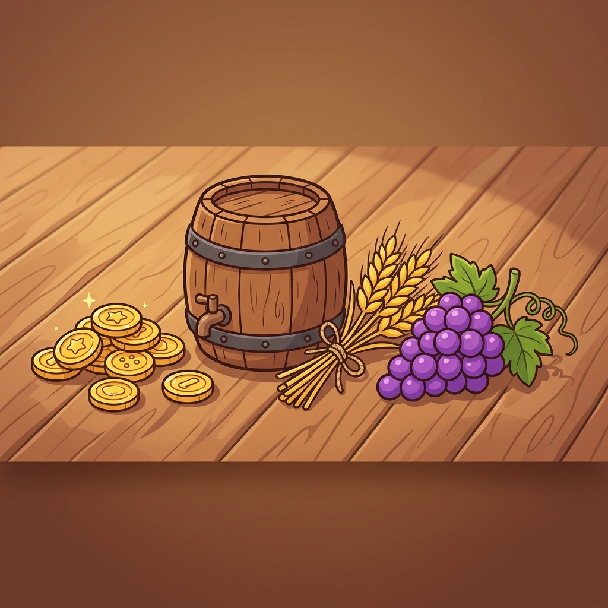

  # 🤖 Guri Bot
  ### O bot de economia, mini-games e cooperação definitivo para o seu servidor Discord!
  ### The Ultimate Economy, Mini-games & Cooperation Bot for Discord!

  

  [**➕ Adicionar ao Discord**](https://discord.com/api/oauth2/authorize?client_id=1507801142892040312&permissions=8&scope=bot%20applications.commands) • 
  [**⭐ Votar no Top.gg**](https://top.gg/bot/1507801142892040312) • 
  [**🌐 Painel Web**](https://guri.discloud.app) • 
  [**💬 Servidor de Suporte**](https://discord.gg/qc2XeXWrbq)

---

🌐 **Multi-language Support / Suporte Multi-idioma:**
O Guri Bot é totalmente bilíngue! Você pode alternar o idioma entre **Português (Brasil)** e **English (US)** a qualquer momento pelo comando `/setup` ou através do nosso painel web em **[guri.discloud.app](https://guri.discloud.app/)**.

This bot is fully bilingual! You can switch the bot's language between **English (US)** and **Português (Brasil)** at any time via `/setup` or the web dashboard.

---

## 🌟 Principais Sistemas e Recursos Visuais

### 🌾 1. Fazenda & Celeiro Interativo (`/fazenda`)
Construa seu império agrícola com visualização gráfica em tempo real:
* **Cultivos Variados:** Plante desde trigo, tomate e café até cultivos ilegais de alto risco e lucro como **Erva** 🌿 e **Cogumelos** 🍄.
* **Celeiro & Criação de Animais:** Crie galinhas, ovelhas e vacas para coletar ovos, lã, leite e fertilizantes.
* **Upgrades:** Expanda terrenos (até 5x5), instale irrigação automatizada e compre colheitadeiras automáticas.

  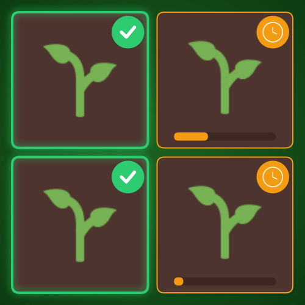
  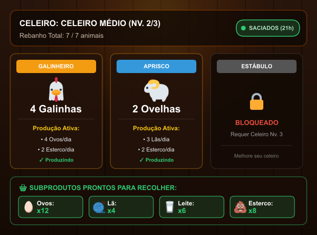

---

### 🏆 2. Dashboard de Ranking em Canvas (`/rank`)
Acompanhe os membros mais ricos do servidor ou do ranking global com uma interface moderna estilo dark dashboard:
* **Top 3 com Medalhas:** Badges temáticas exclusivas para 🥇 Ouro, 🥈 Prata e 🥉 Bronze.
* **Dados Completos:** Exibição detalhada de Carteira, Banco, Patrimônio Líquido Total e Nível do jogador.
* **Navegação Dinâmica:** Paginação ultra-rápida através de botões interativos com emojis customizados.

  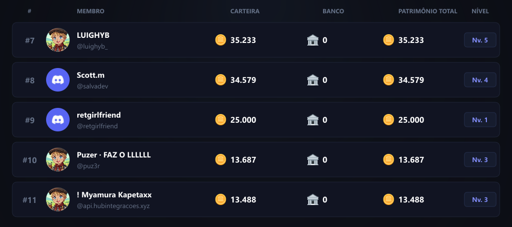

---

### 🍷 3. Vinícola da Serra Gaúcha (`/vinicola`)
Funde e expanda sua própria vinícola para produzir vinhos finos e receber lucro passivo mesmo offline:
* **Castas Nobres:** Isabel, Niágara, Cabernet Sauvignon, Chardonnay e Tannat.
* **Especialistas:** Contrate Colhedores, Sommeliers e Enólogos.
* **Infraestrutura & Marketing:** Instale Prensas Pneumáticas, Barris de Carvalho e amplie o turismo local.

  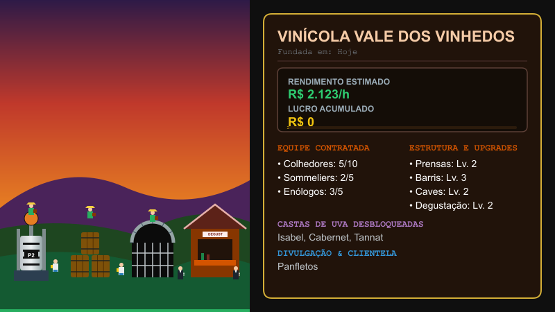

---

### ⛏️ 4. Mineração de Bitcoin & Mercado de Cripto (`/bitcoin`)
Monte rigs de mineração e opere no mercado financeiro de criptomoedas:
* **Equipamentos Customizados:** Antminers S9/S19 e Rigs modulares com até 10 GPUs (GTX 1060, RTX 3080, RTX 4090).
* **Simulação Realista:** Gerencie custos de eletricidade, temperatura e risco de queima de placas.
* **Cotação Flutuante:** Venda seus Bitcoins no momento certo com base no gráfico de cotações dinâmico.

  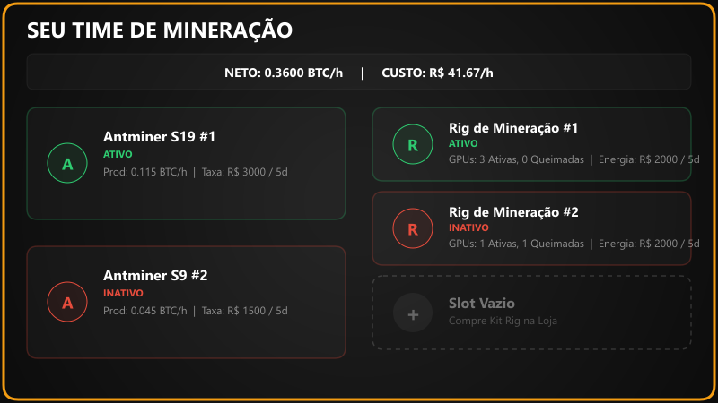
  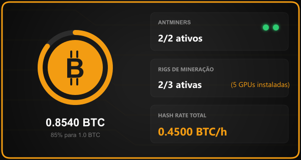

---

### 📈 5. Bolsa de Valores com Gráficos em Tempo Real (`/bolsa`)
Invista em ações do mercado real simuladas com cotações dinâmicas a cada 30 minutos:
* **Ativos Disponíveis:** PETR4, VALE3, ITUB4, MGLU3, AAPL34 e TSLA34.
* **Gráficos em Canvas:** Gráfico de linha de alta precisão mostrando a tendência das últimas 10 rodadas.
* **Home Broker Intuitivo:** Compre e venda ações através de menus interativos e modais de quantidade.

  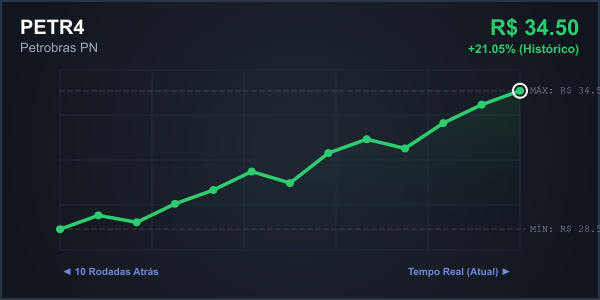

---

### 🎰 6. Cassino Premium em Canvas (`/apostar`)
Aposte suas moedas em mini-games totalmente ilustrados:
* **Caça-Níqueis (Slots):** Caça-níqueis temático com símbolos tradicionais (Chimarrão 🧉, Gaita 🪗, Churrasco 🥩, Cavalo 🐎 e Quero-Quero 🐦).
* **Blackjack (Vinte e Um):** Partidas em mesa verde com cartas físicas e botões de `Pedir` e `Parar`.
* **Roleta Europeia:** Aposte em cores, números ou faixas com visualização da mesa e animação do giro.

  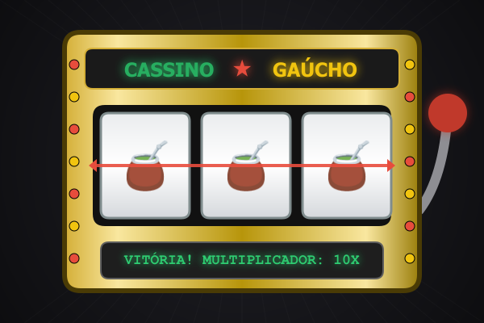
  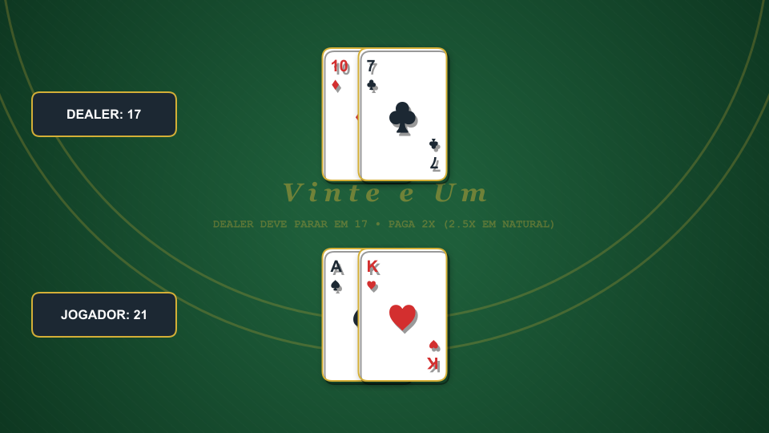
  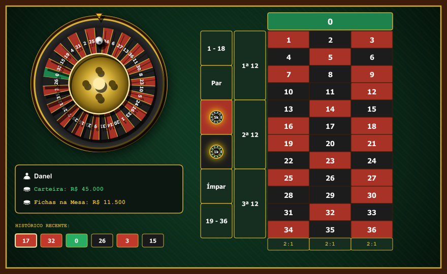

---

### 💼 7. Cartão de Perfil do Jogador (`/perfil`)
Cartão de perfil visual de altíssima definição com estética tradicionalista:
* **Aba Geral:** Informações financeiras completas, nível, XP, patrimônio líquido e renda passiva.
* **Aba Fazenda & Mineração:** Acompanhe suas plantações, celeiro e hashrate diretamente no cartão.
* **Customização:** Títulos exclusivos, badges e molduras colecionáveis.

  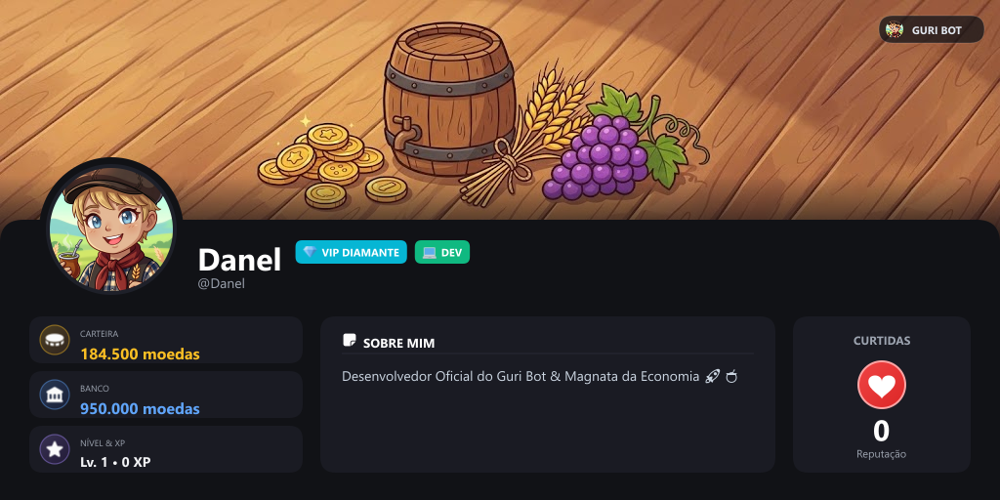

---

### 👥 8. Gangues & Assaltos Cooperativos (`/gangue` e `/assaltar`)
Monte sua facção com amigos para dominar a economia do servidor:
* **Baú da Gangue & Mercado Negro:** Adquira Lockpicks, Pés de Cabra, C4 e Keycards para viabilizar grandes golpes.
* **Assaltos Cooperativos:** Planeje assaltos a Caixas Eletrônicos, Lojas, Carros-Fortes e ao Banco Central.
* **Lavagem de Dinheiro:** Lave o dinheiro sujo no cofre da gangue e divida lucros e XP igualmente.

  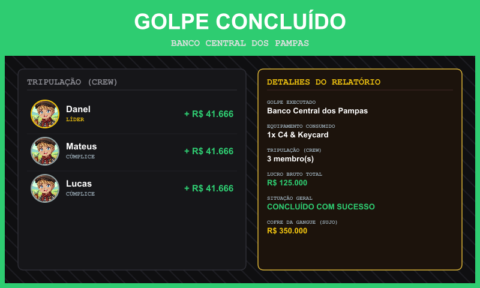

---

## 🛠️ Comandos Principais

| Comando | Descrição |
| :--- | :--- |
| `/fazenda` | Gerencie plantio, colheita, irrigação, celeiro e venda de safras. |
| `/rank` | Visualiza o ranking dos jogadores mais ricos em formato Canvas dinâmico. |
| `/vinicola` | Visualize e evolua sua vinícola para receber lucro passivo contínuo. |
| `/bitcoin` | Central de mineração, instalação de GPUs e negociação de BTC. |
| `/bolsa` | Mercado de ações com gráficos dinâmicos e operações de compra/venda. |
| `/apostar` | Cassino interativo (Slots, Blackjack, Roleta e Cara ou Coroa). |
| `/perfil` | Cartão de perfil em Canvas com conquistas, saldo e títulos. |
| `/gangue` | Crie sua equipe, gerencie o baú coletivo e realize lavagem de dinheiro. |
| `/assaltar` | Planeje e execute assaltos cooperativos com os membros da sua gangue. |
| `/tasks` | Missões diárias dinâmicas com bônus de sequência (streak). |
| `/resgatar` | Painel de recompensas periódicas (horária, diária e semanal). |
| `/work` | Trabalhe para faturar moedas honestas com bônus por rank de XP. |
| `/pesca` | Pesque diferentes espécies com varas e iscas com multiplicadores. |
| `/minerar` | Mineração manual periódica de pedras preciosas e minérios raros. |
| `/vote` | Vote no Top.gg para ganhar moedas e bônus de XP a cada 12h! |

---

  Desenvolvido com carinho para comunidades do Discord • Guri Bot © 2026

